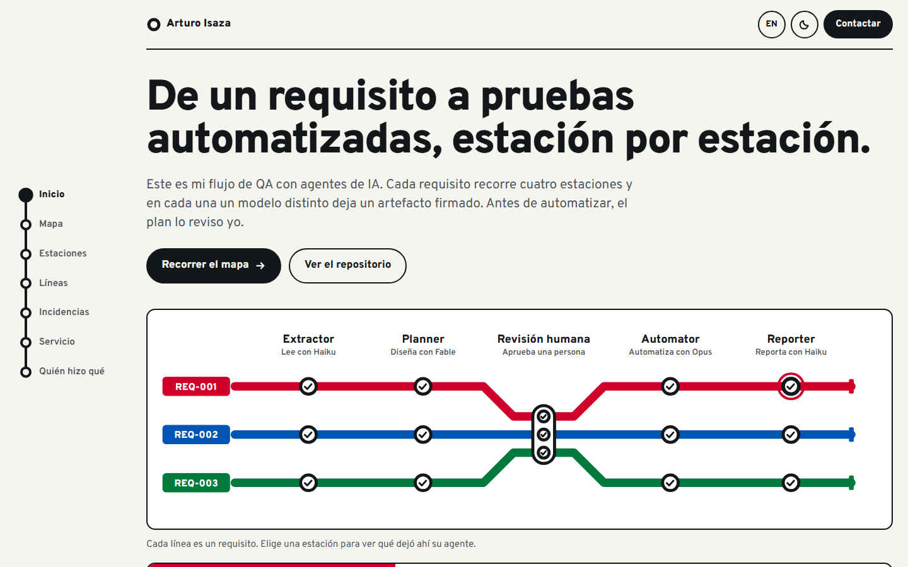
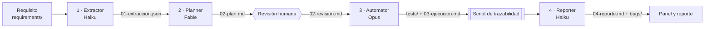

# Flujo de QA con agentes de IA

[](https://github.com/ArturDev98/ai-automatization/actions/workflows/qa.yml)

> **In English:** a QA portfolio project. A requirement goes in and comes out as a test plan,
> Playwright tests, a report and a traceability matrix. Four AI agents do the work, each on the
> model that fits its task, with a human review before anything is automated. The live panel has
> an English toggle; the artifacts are written in Spanish.

**[Abrir el panel →](https://arturdev98.github.io/ai-automatization/)**



Un requisito entra por `requirements/` y sale probado: plan de pruebas, pruebas automatizadas en
Playwright, reporte, bugs y una matriz que demuestra que ningún criterio de aceptación se quedó sin
cubrir. Cada etapa la hace un agente distinto y deja un artefacto versionado que dice qué modelo lo
generó.

## El flujo



| Etapa | Quién | Hace | No puede |
|---|---|---|---|
| 1 · Extractor | Claude Haiku | Lee el requisito y la aplicación real; deja criterios, selectores y endpoints en un JSON | Opinar, diseñar casos o usar datos de memoria |
| 2 · Planner | Claude Fable | Diseña los casos con su técnica, su prioridad por riesgo y qué queda manual | Escribir código o inventar un resultado esperado |
| Revisión | Una persona | Lee el plan, pide cambios o lo aprueba | Saltarse: sin aprobación no se automatiza |
| 3 · Automator | Claude Opus | Convierte los casos en pruebas de Playwright, las corre y las estabiliza | Debilitar un assert para que pase |
| 4 · Reporter | Claude Haiku | Lee los resultados y redacta el reporte y los bugs | Cambiar pruebas o dar una cifra que no esté en los resultados |

### Por qué un modelo distinto en cada etapa

- **Haiku para leer y transcribir.** Extraer criterios o resumir resultados es trabajo de volumen y
  poca ambigüedad: el modelo más rápido y barato alcanza, y sus instrucciones le prohíben opinar.
- **Fable para planear.** Decidir qué probar, con qué técnica y qué riesgo pesa más es donde se
  gana o se pierde la calidad de todo lo demás; ahí va el modelo que mejor razona.
- **Opus para automatizar.** Escribir, correr y estabilizar código contra una aplicación real es
  una tarea larga de ensayo y corrección.

Las reglas de cada agente están en [`.claude/agents/`](.claude/agents) y la orquestación en la
skill [`qa-flow`](.claude/skills/qa-flow/SKILL.md).

## Qué mirar si tienes dos minutos

1. El [panel](https://arturdev98.github.io/ai-automatization/): el mapa del flujo con los datos de la última corrida.
2. Un recorrido completo, el de la compra: [requisito](requirements/REQ-002-catalogo-carrito-y-compra.md) →
   [extracción](artifacts/REQ-002/01-extraccion.json) → [plan](artifacts/REQ-002/02-plan.md) →
   [revisión](artifacts/REQ-002/02-revision.md) → [ejecución](artifacts/REQ-002/03-ejecucion.md) →
   [reporte](artifacts/REQ-002/04-reporte.md).
3. La [matriz de trazabilidad](docs/trazabilidad.md) y los [bugs encontrados](bugs/).

## Cómo se controla a la IA

- **Un artefacto por etapa.** Lo que un agente entrega es la única entrada del siguiente, queda en
  git y se puede auditar. El historial de commits sigue las etapas.
- **Revisión humana antes de automatizar.** El plan no pasa a código hasta que una persona lo
  aprueba, y la decisión queda escrita.
- **La trazabilidad la calcula un script, no un modelo.** [`scripts/trazabilidad.ts`](scripts/trazabilidad.ts)
  cruza el plan con los resultados de Playwright y hace fallar el pipeline si un criterio queda sin
  caso, un caso sin prueba o una prueba fuera del plan.
- **Los asserts no se negocian.** Si la aplicación no hace lo que el plan espera, la prueba queda
  marcada como fallo esperado y se abre un bug; no se ajusta el resultado esperado.
- **Detección comprobada.** La misma suite corre contra una versión de la tienda con defectos
  sembrados; lo que encuentra está en [`bugs/`](bugs/).

## La aplicación bajo prueba

[Toolshop](https://practicesoftwaretesting.com), una tienda de demostración pública pensada para
practicar pruebas: interfaz en Angular, API REST y una [versión con bugs](https://with-bugs.practicesoftwaretesting.com).
No es mía ni tengo relación con sus autores.

| Requisito | Qué cubre | Tipo |
|---|---|---|
| [REQ-001](requirements/REQ-001-acceso-de-clientes.md) | Inicio de sesión, registro y cierre de sesión | Interfaz |
| [REQ-002](requirements/REQ-002-catalogo-carrito-y-compra.md) | Búsqueda, filtros, carrito y compra | Interfaz |
| [REQ-003](requirements/REQ-003-api-de-productos-y-carrito.md) | Productos, sesión y carrito | API |

## Correrlo

Hace falta Node 20 o superior.

```bash
npm ci
npx playwright install chromium

npm test                 # interfaz y API
npm run test:bugs        # la suite de interfaz contra la versión con bugs
npm run trazabilidad     # matriz en docs/trazabilidad.md; falla si falta cobertura
npm run panel            # panel estático en site/dist
npm run test:panel       # comprueba el panel generado
```

Para llevar un requisito nuevo por el flujo, con [Claude Code](https://claude.com/claude-code):
escribe `requirements/REQ-004-lo-que-sea.md` con sus criterios de aceptación y ejecuta
`/qa-flow REQ-004`.

## Estructura

```
.claude/agents/      los cuatro agentes, con su modelo y sus reglas
.claude/skills/      qa-flow, la skill que los orquesta
requirements/        los requisitos (la entrada)
artifacts/REQ-00X/   un artefacto por etapa
bugs/                defectos encontrados, con pasos y evidencia
tests/ui  tests/api  pruebas de Playwright
src/                 page objects, fixtures, clientes de API y datos
scripts/             snapshot, trazabilidad y generador del panel
site/                plantilla del panel
```

## Límites

- La aplicación es de terceros: se regenera cada cierto tiempo y puede responder con errores
  durante unos minutos. En CI las pruebas se reintentan dos veces; en local, ninguna.
- Las pruebas registran sus propios clientes en cada corrida y no usan las cuentas de demostración
  compartidas, que otras personas bloquean. Sus trazas pueden contener la clave de esos clientes
  desechables, por eso los reportes de Playwright no se publican.
- Los agentes proponen; qué es un bug y qué entra al plan lo decide una persona.
- Los casos marcados como manuales en los planes están diseñados, no ejecutados.

## Autor

**Arturo Isaza** · [LinkedIn](https://www.linkedin.com/in/arturo-isaza-qa/) · [GitHub](https://github.com/ArturDev98)
