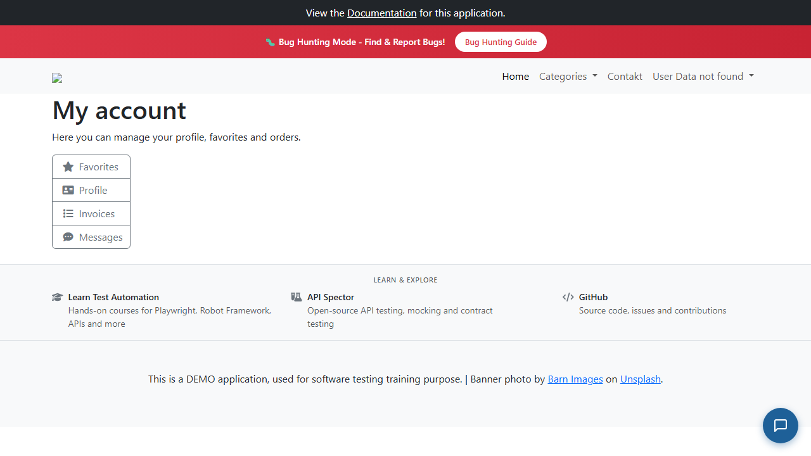

# BUG-001 · Tras iniciar sesión, el menú no muestra el nombre del cliente y My account dice "User Data not found"

- **Requisito:** REQ-001
- **Casos:** TC-001, TC-006
- **Ambiente:** ui-bugs · https://with-bugs.practicesoftwaretesting.com
- **Severidad:** Alta

**Prioridad: Alta.** Es el paso que confirma que el cliente entró: CA-1 y CA-4 exigen que el menú muestre su nombre y que la cuenta cargue. Con este defecto el cliente llega a la cuenta pero ve un error en vez de sus datos.

## Pasos para reproducir

Con la versión con bugs (la ruta de inicio de sesión lleva almohadilla: `#/auth/login`):

1. Abrir `https://with-bugs.practicesoftwaretesting.com/#/auth/login`.
2. Escribir el correo y la clave de un cliente registrado (en TC-006, el cliente creado en el registro).
3. Pulsar `login-submit`.
4. Observar la URL, el título de la página y el menú superior (`nav-user-menu`).

Con la suite: `npx playwright test --project=ui-bugs -g "@REQ-001.*@TC-001"` (y, para el otro caso, `-g "@REQ-001.*@TC-006"`).

## Resultado esperado

Tras pulsar `login-submit`, la URL pasa a `/account`, la página se identifica como "My account" y el menú superior muestra el nombre del cliente (en la suite, "Valeria").

## Resultado obtenido

La URL llega a `/#/account` y la página es "My account", pero `nav-user-menu` muestra ` User Data not found `. La petición `GET /users/me` responde 200 (dato de la traza). En TC-006 el cliente se registró por la propia interfaz, así que el fallo no viene del alta por API.

## Evidencia

- 
- 
- Traza: no versionada. Se regenera con `npx playwright test --project=ui-bugs -g "@REQ-001" --trace=on`.
