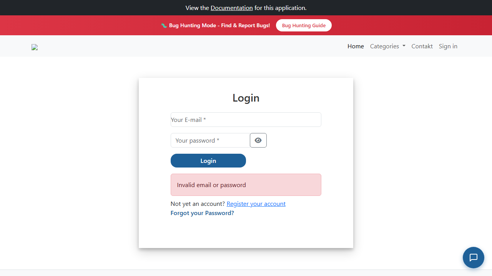

# BUG-002 · El inicio de sesión con correo y clave vacíos envía la petición en vez de mostrar un error en cada campo

- **Requisito:** REQ-001
- **Casos:** TC-004
- **Ambiente:** ui-bugs · https://with-bugs.practicesoftwaretesting.com
- **Severidad:** Media

**Prioridad: Media.** La validación de campos obligatorios no ocurre en el formulario; el servidor responde, pero el cliente recibe un error genérico de credenciales en vez de saber qué falta. No bloquea a un cliente con datos correctos.

## Pasos para reproducir

1. Abrir `https://with-bugs.practicesoftwaretesting.com/#/auth/login` sin sesión.
2. Dejar `email` y `password` vacíos.
3. Pulsar `login-submit`.
4. Observar los campos, los mensajes y la red.

Con la suite: `npx playwright test --project=ui-bugs -g "@REQ-001.*@TC-004"` (falla en la combinación "ambos vacíos").

## Resultado esperado

Aparece un mensaje de error junto al campo correo y otro junto al campo clave. No sale ninguna petición `POST /users/login` y no aparece "Invalid email or password".

## Resultado obtenido

No aparece `email-error` (`element(s) not found`). Sale `POST /users/login` con respuesta 401 y se muestra "Invalid email or password".

## Evidencia

- 
- Traza: `test-results/<prueba>-ui-bugs/trace.zip` (mismo comando que BUG-001 con `--trace=on`). Dato de la red: `POST /users/login 401` según la traza de la ejecución.
