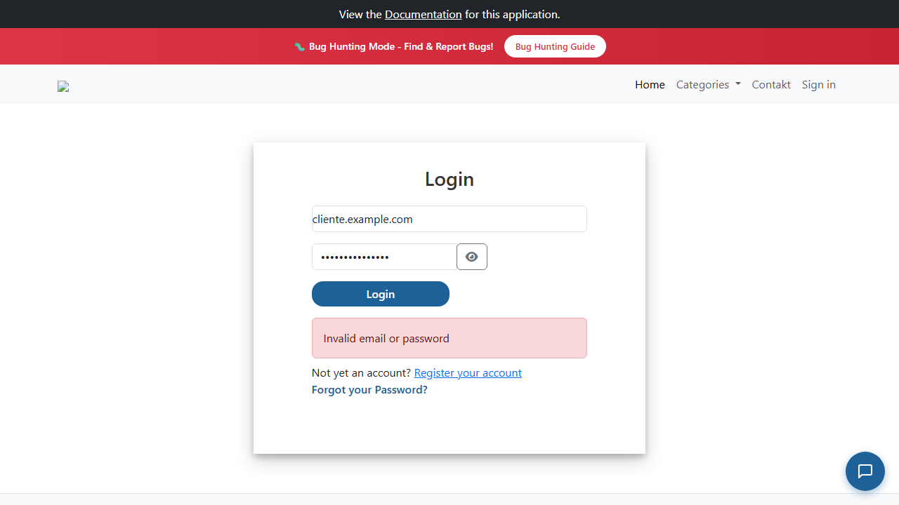

# BUG-003 · El inicio de sesión no valida el formato del correo y envía la petición

- **Requisito:** REQ-001
- **Casos:** TC-005
- **Ambiente:** ui-bugs · https://with-bugs.practicesoftwaretesting.com
- **Severidad:** Media

**Prioridad: Media.** Un correo mal escrito no se marca en su campo y el formulario sale igual al servidor. El cliente recibe un error de credenciales en lugar de la corrección que pide CA-3. No impide entrar a quien escribe bien su correo.

## Pasos para reproducir

1. Abrir `https://with-bugs.practicesoftwaretesting.com/#/auth/login` sin sesión.
2. Escribir en `email` el correo `cliente.example.com` (sin arroba).
3. Escribir en `password` una clave bien formada.
4. Pulsar `login-submit`.
5. Observar el campo correo y la red.

Con la suite: `npx playwright test --project=ui-bugs -g "@REQ-001.*@TC-005"` (falla en el primer dato, `cliente.example.com`).

## Resultado esperado

El campo correo muestra su mensaje de error de formato. El campo clave no muestra error. No sale ninguna petición `POST /users/login`, la URL sigue en `/auth/login` y no aparece "Invalid email or password".

## Resultado obtenido

No aparece `email-error` (`element(s) not found`). Sale `POST /users/login` con respuesta 401. El campo `email` es `type=text` y no hay validación en el cliente. Los otros dos datos del caso (`cliente@` y `@example.com`) no se ejecutaron tras el primer fallo: sin dato de si fallan igual.

## Evidencia

- 
- Traza: `test-results/<prueba>-ui-bugs/trace.zip` (comando de BUG-001 con `--trace=on`).
