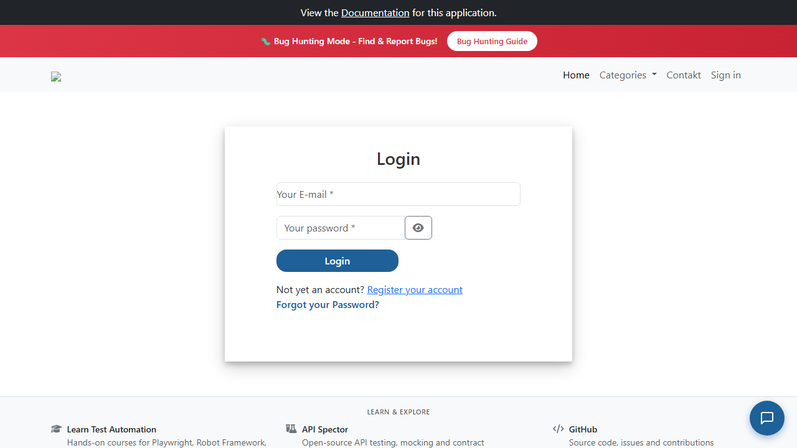

# BUG-004 · El registro acepta claves sin mayúscula, minúscula, número ni símbolo: solo exige longitud

- **Requisito:** REQ-001
- **Casos:** TC-008
- **Ambiente:** ui-bugs · https://with-bugs.practicesoftwaretesting.com
- **Severidad:** Alta

**Prioridad: Alta.** La política de clave de CA-5 deja de cumplirse: cualquier clave de 8 caracteres o más entra. Es un defecto de seguridad de cuentas, y la API con bugs también lo muestra al explorar (ver el informe de REQ-001).

## Pasos para reproducir

1. Abrir `https://with-bugs.practicesoftwaretesting.com/#/auth/register`.
2. Llenar el perfil válido con un correo único que nunca se haya registrado.
3. En `password`, escribir una clave de 8 caracteres o más sin mayúscula (por ejemplo, `clave-segura-1!`).
4. Pulsar `register-submit`.
5. Observar la URL y el campo clave.

Repetir con claves sin minúscula, sin número y sin símbolo (exploración manual: el mismo perfil también se acepta).

Con la suite: `npx playwright test --project=ui-bugs -g "@REQ-001.*@TC-008"` (falla en la fila "sin mayúscula").

## Resultado esperado

El registro no se acepta: la URL sigue en `/auth/register`, el campo clave muestra un error y no hay redirección a `/auth/login`.

## Resultado obtenido

`POST /users/register` responde 201 y la app redirige a `/#/auth/login`. No aparece `password-error` (`element(s) not found`). En la exploración manual, con el mismo perfil, también se aceptan claves sin minúscula, sin número y sin símbolo: solo se exige la longitud.

## Evidencia

- 
- Traza: `test-results/<prueba>-ui-bugs/trace.zip` (red: `POST /users/register 201`). La captura de la exploración manual sin minúscula, número y símbolo: sin dato en el repositorio.
