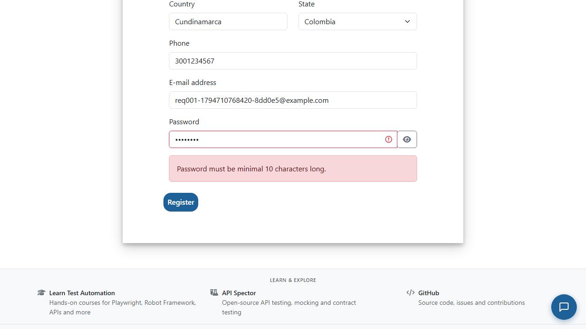

# BUG-005 · El registro rechaza una clave válida de 8 caracteres y exige 10

- **Requisito:** REQ-001
- **Casos:** TC-009
- **Ambiente:** ui-bugs · https://with-bugs.practicesoftwaretesting.com
- **Severidad:** Alta

**Prioridad: Alta.** CA-5 fija el mínimo en 8 caracteres. Con este defecto un cliente que elige una clave válida no puede registrarse y ve un mensaje que contradice la política publicada en el requisito.

## Pasos para reproducir

1. Abrir `https://with-bugs.practicesoftwaretesting.com/#/auth/register`.
2. Llenar el perfil válido con un correo único sin registrar.
3. En `password`, escribir una clave de 8 caracteres con mayúscula, minúscula, número y símbolo (por ejemplo, `Abcdef1!`).
4. Pulsar `register-submit`.
5. Observar la URL, el mensaje del campo clave y la red.

Con la suite: `npx playwright test --project=ui-bugs -g "@REQ-001.*@TC-009"` (falla en el paso "8 caracteres").

## Resultado esperado

El registro se acepta y la app lleva a `/auth/login`.

## Resultado obtenido

La URL se queda en `/#/auth/register` con el mensaje `Password must be minimal 10 characters long.`. No sale ninguna petición de registro.

## Evidencia

- 
- Traza: `test-results/<prueba>-ui-bugs/trace.zip` (comando de BUG-001 con `--trace=on`).
