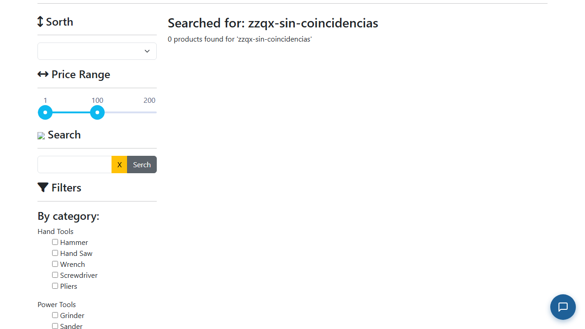

# BUG-006 · Una búsqueda sin coincidencias no muestra el mensaje de "no hay productos"

- **Requisito:** REQ-002
- **Casos:** TC-002
- **Ambiente:** ui-bugs · https://with-bugs.practicesoftwaretesting.com
- **Severidad:** Media

**Prioridad: Media.** CA-1 exige que, sin coincidencias, el catálogo muestre un mensaje que lo diga. Sin él, el cliente ve un listado vacío sin saber si la búsqueda falló o si la tienda no tiene nada. No bloquea la compra, pero deja la búsqueda sin respuesta clara.

## Pasos para reproducir

1. Abrir `https://with-bugs.practicesoftwaretesting.com` (catálogo, sin filtros tocados).
2. Escribir `zzqx-sin-coincidencias` en el campo de búsqueda y pulsar Search.
3. Observar el área de resultados.

Con la suite: `npx playwright test --project=ui-bugs -g "@REQ-002.*@TC-002"`

## Resultado esperado

Cero tarjetas de producto y un mensaje visible de que no hay productos (en `ui`, `no-results`, "There are no products found.").

## Resultado obtenido

Las tarjetas quedan en cero, pero el mensaje no aparece: `expect(locator).toBeVisible() failed — Locator: getByTestId('no-results') — Expected: visible — element(s) not found`. La captura muestra solo "Searched for: …" y "0 products found for '…'"; el contenedor `search_completed` queda vacío.

## Evidencia

- 
- Traza: no versionada. Se regenera con `npx playwright test --project=ui-bugs -g "@REQ-002" --trace=on`.
