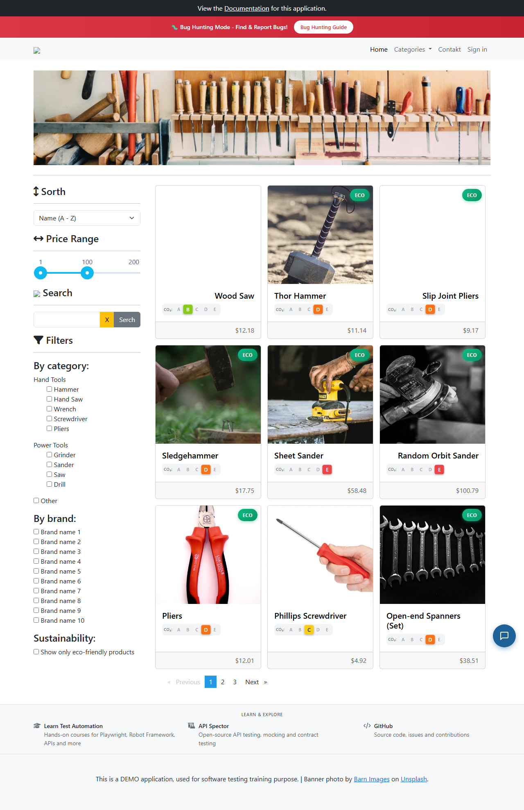
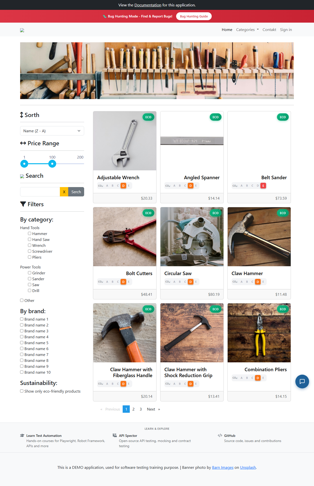
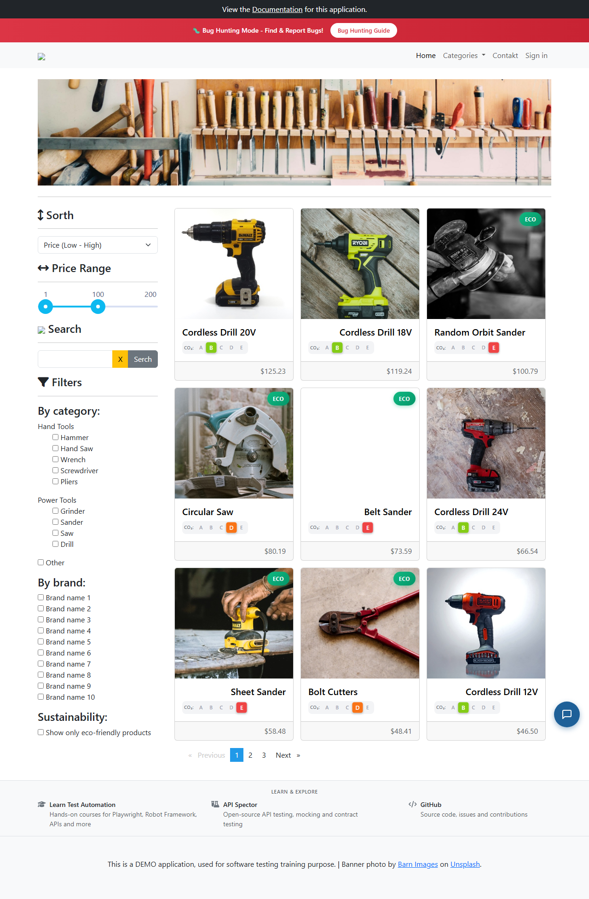
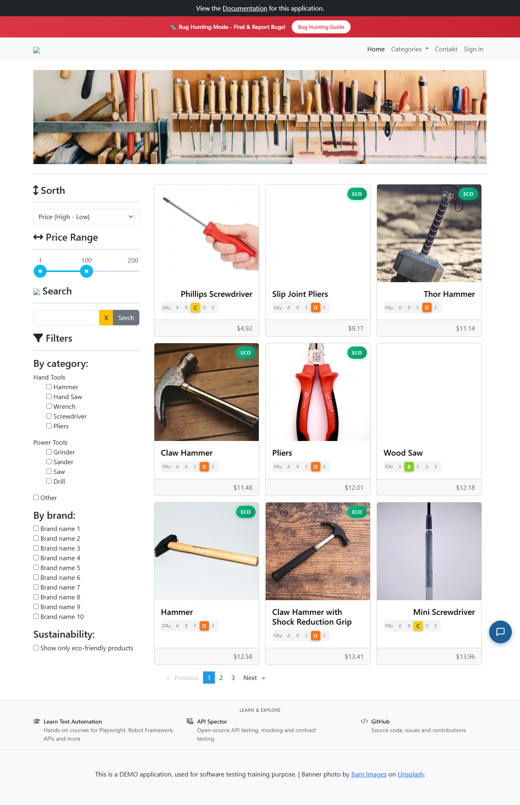

# BUG-007 · Cada opción de orden del catálogo aplica el sentido contrario

- **Requisito:** REQ-002
- **Casos:** TC-004, TC-005
- **Ambiente:** ui-bugs · https://with-bugs.practicesoftwaretesting.com
- **Severidad:** Alta

**Prioridad: Alta.** CA-3 exige que el orden mostrado corresponda al elegido, y TC-005 es de prioridad Alta. Las cuatro opciones de orden (nombre y precio) devuelven el sentido opuesto, así que el cliente que busca el más barato o el más caro ve la lista al revés.

## Pasos para reproducir

1. Abrir `https://with-bugs.practicesoftwaretesting.com` y elegir en `sort` la opción `Name (A - Z)`.
2. Leer los nombres de la primera página.
3. Repetir con `Name (Z - A)`, `Price (Low - High)` y `Price (High - Low)` y leer los precios de la primera página.

Con la suite (las cuatro filas): `npx playwright test --project=ui-bugs -g "@REQ-002.*@TC-004"` y `npx playwright test --project=ui-bugs -g "@REQ-002.*@TC-005"`

## Resultado esperado

La página 1 queda en el orden elegido: A-Z para `Name (A - Z)`, Z-A para `Name (Z - A)`, de menor a mayor para `Price (Low - High)` y de mayor a menor para `Price (High - Low)`.

## Resultado obtenido

Cada opción devuelve el orden contrario. Con `Name (A - Z)` la lista empieza por Wood Saw, Thor Hammer, Slip Joint Pliers (Z-A). Con `Name (Z - A)` llega en A-Z. Con `Price (Low - High)` llega de mayor a menor (125.23, 119.24, 100.79). Con `Price (High - Low)` llega de menor a mayor (4.92, 9.17, 11.14). El fallo es `página 1 con "<opción>"` (`expect(received).toEqual(expected)`), antes de comparar con el oráculo.

En el select de esa versión, cada etiqueta tiene el valor del sentido opuesto (por ejemplo, `Name (A - Z)` = `name,desc` y `Price (High - Low)` = `price,asc`).

## Evidencia

- 
- 
- 
- 
- Trazas: `results/req002-bugs-orden/catalogo-Catálogo-búsqueda-c2344-ja-los-nombres-en-ese-orden-ui-bugs/trace.zip`, `…-640fe-…-ui-bugs/trace.zip`, `…-5858d-…-ui-bugs/trace.zip` y `…-58249-…-ui-bugs/trace.zip` (en `results/req002-bugs-orden/`).
