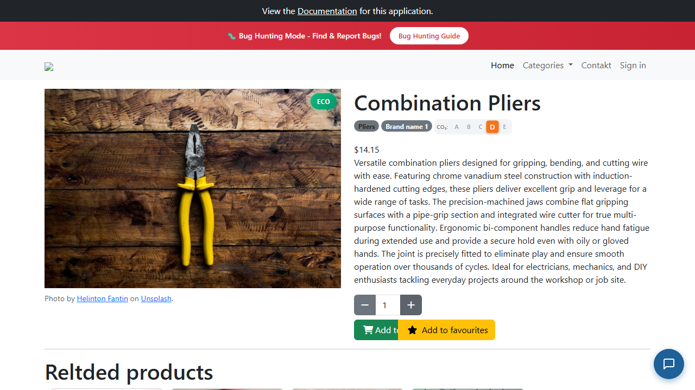

# BUG-008 · El botón de aumentar cantidad en el detalle no sube la cantidad

- **Requisito:** REQ-002
- **Casos:** TC-007
- **Ambiente:** ui-bugs · https://with-bugs.practicesoftwaretesting.com
- **Severidad:** Media

**Prioridad: Media.** CA-4 pide elegir la cantidad desde el detalle. El campo sí acepta un valor escrito (TC-006 pasa en esta versión), así que el cliente puede comprar, pero el botón de subir no hace nada y el contador del carrito queda con una unidad menos de la esperada.

## Pasos para reproducir

1. Abrir `https://with-bugs.practicesoftwaretesting.com` y entrar al detalle de Combination Pliers.
2. Leer el valor de `quantity` (1 por defecto).
3. Pulsar `increase-quantity` una vez.
4. Leer `quantity`.

Con la suite: `npx playwright test --project=ui-bugs -g "@REQ-002.*@TC-007"`

## Resultado esperado

Tras un clic en `increase-quantity`, `quantity` pasa de 1 a 2.

## Resultado obtenido

`expect(locator).toHaveValue(expected) failed — Locator: getByTestId('quantity') — Expected: "2" — Received: "1"`. La exploración previa dio lo mismo: tras el clic el campo sigue en 1 y el contador queda en 1.

## Evidencia

- 
- Traza: `results/req002-evidencia-bugs/compra-carrito-Carrito-can-5bc35-uctos-distintos-y-no-líneas-ui-bugs/trace.zip`
