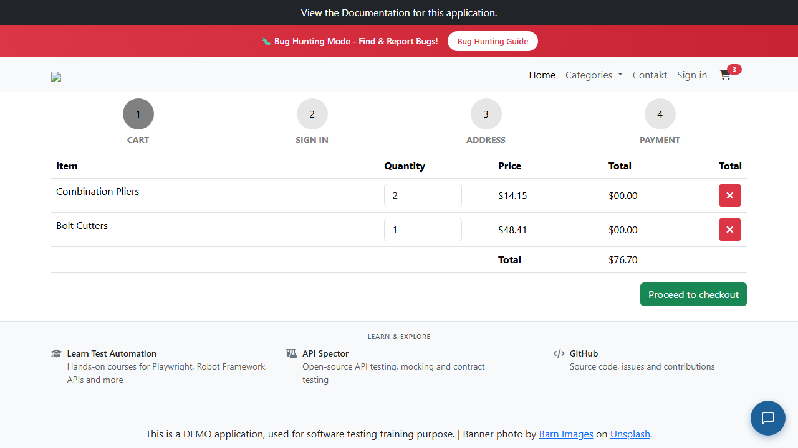

# BUG-009 · El total de cada línea del carrito muestra $00.00

- **Requisito:** REQ-002
- **Casos:** TC-008, TC-009
- **Ambiente:** ui-bugs · https://with-bugs.practicesoftwaretesting.com
- **Severidad:** Alta

**Prioridad: Alta.** Es el riesgo de mayor impacto del plan: el total de línea es lo que el cliente ve como importe a pagar. Con $00.00 en cada línea, el cliente no sabe cuánto paga por cada producto. El total general sí es correcto ($173.53), así que el defecto está en el cálculo por línea.

## Pasos para reproducir

1. Abrir `https://with-bugs.practicesoftwaretesting.com`.
2. Agregar Combination Pliers con cantidad 2 y Bolt Cutters con cantidad 3, desde sus detalles.
3. Abrir el carrito (`/checkout`, paso carrito).
4. Leer el total de cada línea y el total general.

Con la suite: `npx playwright test --project=ui-bugs -g "@REQ-002.*@TC-008"` y `npx playwright test --project=ui-bugs -g "@REQ-002.*@TC-009"`

## Resultado esperado

Total de línea de Combination Pliers = 2 × 14.15 = 28.30; total de línea de Bolt Cutters = 3 × 48.41 = 145.23; total general = 173.53.

## Resultado obtenido

`total de línea de Combination Pliers (2 u.) — expect(received).toBe(expected) — Expected: 2830 — Received: 0`. La captura muestra $00.00 en el total de las dos líneas. Los precios unitarios ($14.15 y $48.41) y el total general ($173.53) son correctos.

TC-009 falla en la misma verificación, porque el plan la usa como precondición (totales iniciales). El recálculo al cambiar la cantidad no llega a probarse en esta versión.

## Evidencia

- 
- 
- Trazas: `results/req002-evidencia-bugs/compra-carrito-Carrito-can-a027a-tal-general-igual-a-la-suma-ui-bugs/` (TC-008) y `results/req002-evidencia-bugs/compra-carrito-Carrito-can-93af9-la-línea-y-el-total-general-ui-bugs/` (TC-009), con `test-failed-1.png` y `trace.zip`.
