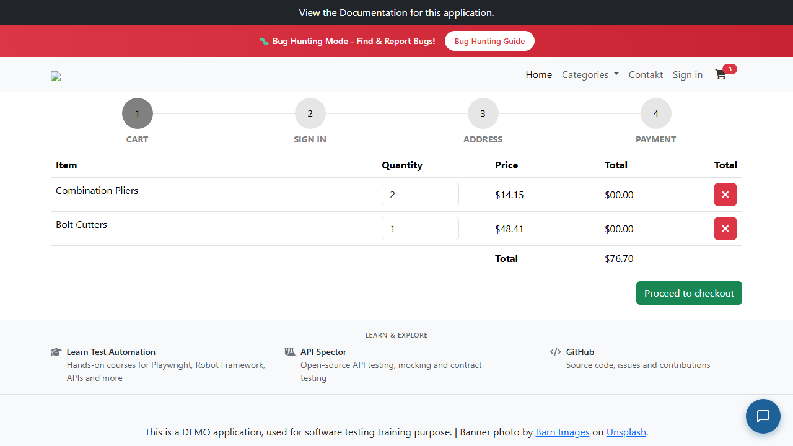

# BUG-010 · El total general del carrito sale un centavo menos con Combination Pliers ×2 y Bolt Cutters ×1

- **Requisito:** REQ-002
- **Casos:** TC-010
- **Ambiente:** ui-bugs · https://with-bugs.practicesoftwaretesting.com
- **Severidad:** Alta

**Prioridad: Alta.** El total general es el importe que el cliente paga. Un centavo de diferencia es poco dinero, pero es un error de cálculo sobre el cobro, y el plan lo clasifica como el riesgo de mayor impacto. El error depende de los importes: con otra combinación (TC-008, A×2 y B×3) el total sale exacto.

## Pasos para reproducir

1. Abrir `https://with-bugs.practicesoftwaretesting.com`.
2. Agregar Combination Pliers con cantidad 2 y Bolt Cutters con cantidad 1.
3. Abrir el carrito y leer el total general.

Con la suite: `npx playwright test --project=ui-bugs -g "@REQ-002.*@TC-010"`

## Resultado esperado

Total general = 14.15 × 2 + 48.41 = 76.71.

## Resultado obtenido

`total inicial — expect(received).toBe(expected) — Expected: 7671 — Received: 7670`. La captura muestra $76.70.

Es la precondición de TC-010, así que el paso de quitar un producto no se llega a probar en esta versión.

## Evidencia

- 
- Traza: `results/req002-evidencia-bugs/compra-carrito-Carrito-can-e8e4e--lista-y-actualiza-el-total-ui-bugs/trace.zip`
