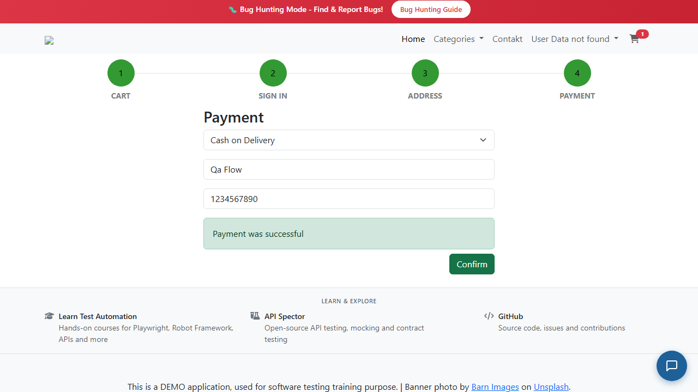

# BUG-011 · Tras confirmar el pago no aparece el número de factura (la API de facturas responde 500)

- **Requisito:** REQ-002
- **Casos:** TC-012
- **Ambiente:** ui-bugs · https://with-bugs.practicesoftwaretesting.com
- **Severidad:** Alta

**Prioridad: Alta.** CA-8 exige que, al confirmar, el cliente vea el pago exitoso y un número de factura. Sin factura, el cliente no tiene comprobante de la compra. El pago sí llega a "Payment was successful", así que el fallo está después del cobro.

## Pasos para reproducir

1. Abrir `https://with-bugs.practicesoftwaretesting.com` y registrar un cliente nuevo (la suite lo hace por `POST /users/register`); iniciar sesión con él.
2. Agregar Combination Pliers con cantidad 1 y abrir `/checkout`.
3. Paso carrito: avanzar. Paso sesión: avanzar. Paso dirección: confirmar la dirección y avanzar.
4. Paso pago: elegir "Cash on Delivery", completar los campos que pide la pantalla (en esta versión, titular y número de cuenta) y confirmar.
5. Observar la pantalla de confirmación.

Con la suite: `npx playwright test --project=ui-bugs -g "@REQ-002.*@TC-012"`

## Resultado esperado

Tras confirmar, el mensaje de pago exitoso y un número de factura no vacío (en la suite, el texto "your invoice number is" seguido de un token).

## Resultado obtenido

El mensaje "Payment was successful" sí aparece. El número de factura no: `expect(locator).toHaveText(expected) failed — Locator: getByText(/your invoice number is/i) — element(s) not found`.

En la traza, `POST https://api-with-bugs.practicesoftwaretesting.com/invoices` responde **500**; antes, `POST /payment/check` había respondido 200. En el select de pago de esta versión aparece además la opción "Errror 304 - Missing Payment Gateway", y ese texto también se ve en la pantalla de pago.

## Evidencia

- 
- Traza (pestaña Network con el 500 de `/invoices`): `results/req002-evidencia-bugs/compra-pago-Compra-con-ses-f3ed5-exitoso-y-número-de-factura-ui-bugs/trace.zip`
