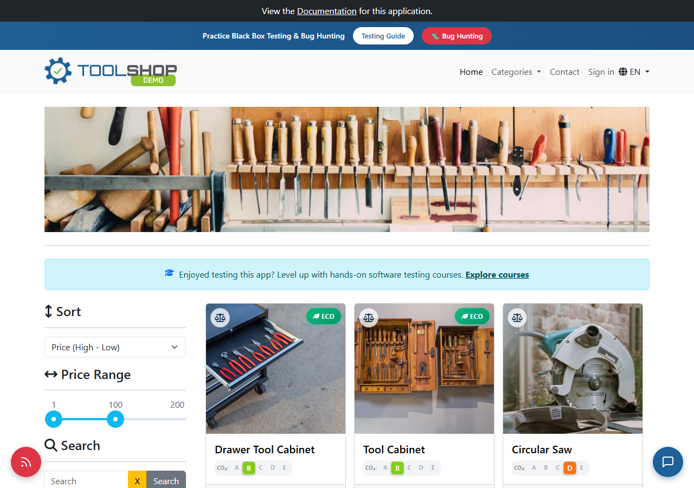

# BUG-012 · El catálogo aplica por defecto un rango de precio de 1 a 100 que oculta productos sin avisar

- **Requisito:** REQ-002
- **Casos:** TC-004, TC-005 (origen: H-01)
- **Ambiente:** ui · https://practicesoftwaretesting.com
- **Severidad:** Baja

**Prioridad: Baja.** Ninguna prueba falla por este defecto: tras el cambio de plan, TC-004 y TC-005 comparan solo el orden de lo que el catálogo muestra. Queda como observación reportada. Afecta a quien ordena de mayor a menor y no ve los productos más caros, sin ningún aviso de que hay filtro activo. Por eso es Baja y no Media.

## Pasos para reproducir

1. Abrir `https://practicesoftwaretesting.com` (catálogo, sin tocar el control de rango de precio).
2. Leer el control "Price Range": los extremos quedan en 1 y 100.
3. Elegir en `sort` la opción `Price (High - Low)` y leer el primer producto.
4. Comparar con el orden de la API: `GET /products?sort=price,desc` devuelve primero "Workbench with Drawers" a $178.20.

Con la suite: no hay prueba que lo afirme; la traza de la corrida muestra la petición a `/products` con `between=price,1,100` e `is_rental=false` (ver ruta de evidencia).

## Resultado esperado

El catálogo muestra todos los productos del catálogo, o avisa de que hay un filtro de precio activo y deja quitarlo. Al ordenar de mayor a menor, el primero mostrado es el de precio más alto.

## Resultado obtenido

Al cargar, el control de precio marca 1 y 100 y la petición lleva `between=price,1,100`. El catálogo oculta 5 de los 50 productos: Workbench with Drawers, Wooden Workbench, Cordless Drill 20V, Cordless Drill 18V y Random Orbit Sander. Con `Price (High - Low)` el primero mostrado es $89.55, mientras la API devuelve primero Workbench with Drawers a $178.20.

Datos comprobados en vivo el 2026-11-14 durante la revisión, fuera de la suite: con `Price (High - Low)` la interfaz mostró $89.55, $86.71 y $80.19 como los tres primeros, y `GET /products?sort=price,desc` devolvió Workbench with Drawers ($178.20), Wooden Workbench ($172.52) y Cordless Drill 20V ($125.23).

## Evidencia

- 
- Trazas de la corrida en `ui` (petición con `between=price,1,100`): `results/req002-evidencia-ui/catalogo-Catálogo-búsqueda-640fe-ja-los-nombres-en-ese-orden-ui/trace.zip` y `results/req002-evidencia-ui/catalogo-Catálogo-búsqueda-58249-s-precios-en-orden-numérico-ui/trace.zip`.
